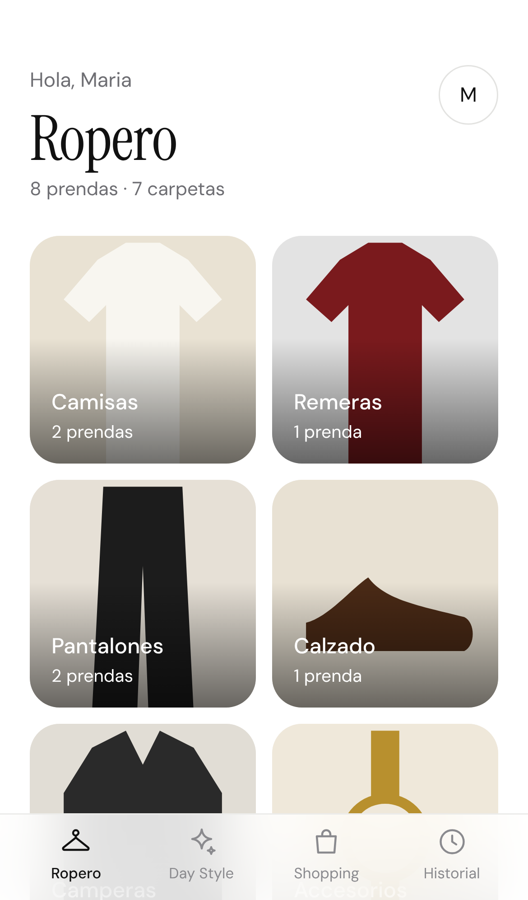
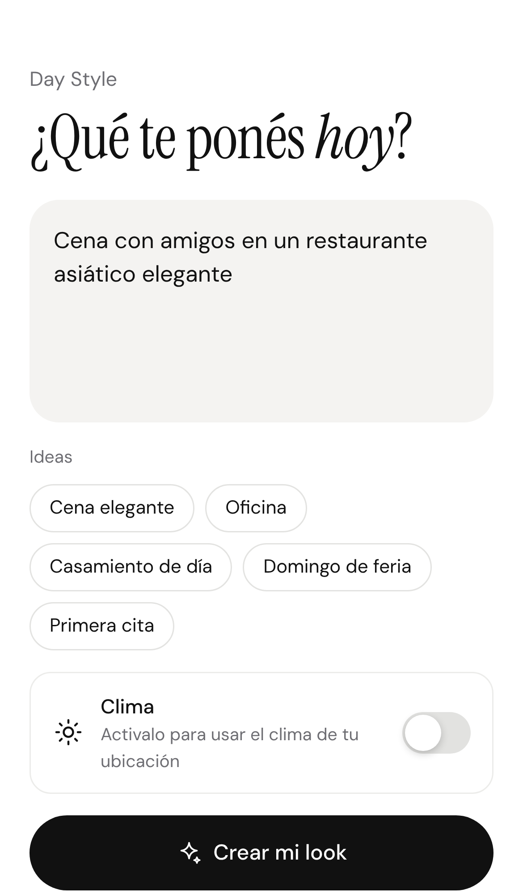
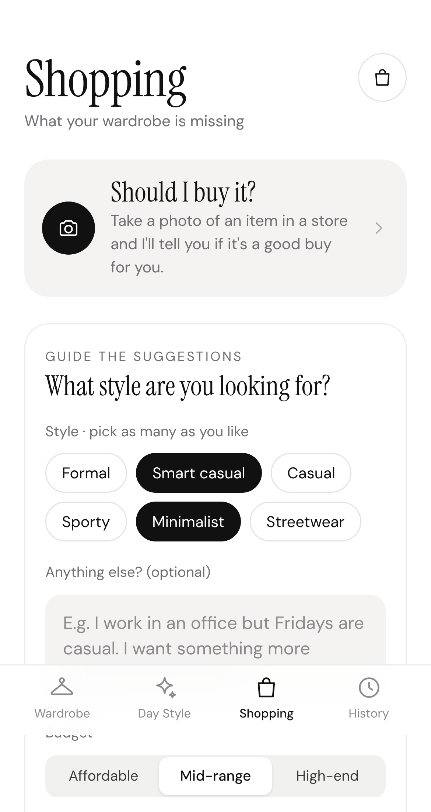

# DressCode

[English](README.md) · **Español**

[](LICENSE)
[](https://github.com/Pablo-Mdz/DressCode/actions/workflows/ci.yml)
[](#6-instalarla-en-el-celular)
[](https://github.com/Pablo-Mdz/DressCode/stargazers)

Tu ropero personal y tu estilista con IA, en una sola app instalable. Sacale una foto a cada prenda una vez; a partir de ahí, DressCode te sugiere looks para cualquier ocasión, recrea looks a partir de una foto de inspiración, arma la valija de un viaje con el pronóstico real y te dice si una prenda que viste en una tienda vale la pena comprar — siempre usando ropa que ya tenés.

Es una PWA (se instala en el celular desde el navegador), hecha con React, Firebase y la API de Claude — **y es tuya para alojar donde quieras.** La clonás, la conectás a tu propio proyecto de Firebase y tu propia clave de Anthropic, y corre bajo tu control total: tus fotos, tu base de datos, tu gasto de IA, sin pasar por ningún servidor ajeno. Tiene:

<p align="center">
  
  
  
</p>

<p align="center"><sub>La app funciona en español e inglés — se cambia desde el login o desde Cuenta. Las capturas de arriba están en inglés.</sub></p>

- **Ropero**: tus prendas organizadas en carpetas. Vienen 7 por defecto (Camisas, Remeras, Pantalones, Calzado, Camperas, Accesorios, Otros) y podés crear, renombrar o borrar las que quieras. Cada prenda se sube con la cámara o desde la galería, con una descripción opcional.
- **Day Style**: describís la ocasión ("cena con amigos en un restaurante asiático elegante") y Claude mira las fotos de tu ropero y te propone 2 o 3 outfits armados con tu ropa, teniendo en cuenta el clima del día.
- **Inspiración** (dentro de Day Style): subís la foto de un look que te gusta (Instagram, Pinterest, la calle) y la IA lo recrea con tu ropa. Te dice qué tan parecido queda y qué prendas te faltarían para acercarte más; esas las podés sumar a tu lista de compras.
- **Planificar** (dentro de Day Style): un look por día para un viaje (destino, fecha, días y planes) o para la semana en casa. Usa el pronóstico real si el viaje empieza dentro de los próximos 16 días, y arma la valija con todas las prendas, sin repetir.
- **Shopping**: la IA analiza tu ropero y te dice qué comprar para tener más variedad (por ejemplo, un pantalón azul marino que va con tus camisas celestes y blancas). Podés orientarla por estilo (formal, casual, deportivo…), presupuesto, temporada y con un comentario libre. Las sugerencias que te gustan van a **Mi lista**; con "Ya la tengo" no te las vuelve a sugerir.
- **¿Lo compro?** (dentro de Shopping): sacale una foto a una prenda en la tienda y la IA te dice si conviene, con qué prendas tuyas combina y si ya tenés algo parecido.
- **Etiquetado automático**: al subir una prenda, la IA detecta tipo, color, temporada y formalidad (y completa la descripción si está vacía). Permite filtrar cada carpeta y mejora los looks.
- **Subida múltiple**: desde la galería se pueden elegir hasta 20 fotos juntas. Se suben en segundo plano y, en modo *Automática*, la IA pone cada prenda en su carpeta.
- **Fondo blanco**: al subir una foto, el fondo se quita en el propio teléfono (gratis, sin servidores) y la prenda queda centrada sobre blanco. También se puede aplicar a prendas ya subidas.
- **Looks en pareja**: desde Cuenta invitás a tu pareja por email; cuando acepta, en Day Style aparece "Para los dos" y la IA arma looks coordinados con los dos roperos. Cada uno sigue viendo solo sus propias prendas; el historial de looks en pareja es compartido.
- **Historial**: todos los looks que pediste, con la opción de marcar el que elegiste.
- **Cuentas separadas**: cada persona entra con email y contraseña o con Google, y solo ve su propio ropero.

**Stack:** React + Vite (PWA), Firebase (Auth, Firestore, Storage, Cloud Functions) y la API de Anthropic. El sitio se publica en Netlify.

---

## Puesta en marcha

### 1. Proyecto de Firebase

1. Entrá a <https://console.firebase.google.com> y creá un proyecto (por ejemplo `dresscode`). Google Analytics no hace falta.
2. **Plan Blaze**: abajo a la izquierda, *Upgrade* → *Blaze*. Storage y Cloud Functions lo requieren. Para dos personas el uso entra holgado en la cuota gratuita, pero conviene crear una **alerta de presupuesto** (por ejemplo de USD 1) en Google Cloud → Facturación → Presupuestos.
3. **Authentication** → *Comenzar* → *Sign-in method*:
   - Activá **Correo electrónico/contraseña**.
   - Activá **Google** y elegí un email de soporte.
4. **Firestore Database** → *Crear base de datos* → modo **producción**, región `europe-west` (o la más cercana a ustedes).
5. **Storage** → *Comenzar* → modo producción, misma región.
6. **Configuración del proyecto** (ícono de engranaje) → *Tus apps* → agregá una app **Web** (`</>`). Copiá los valores de `firebaseConfig`, los vas a necesitar en los pasos 3 y 4.

### 2. Reglas de seguridad y función de IA

Hacé esto desde tu computadora, con Node 22 instalado:

```bash
npm install -g firebase-tools
firebase login

git clone https://github.com/Pablo-Mdz/DressCode.git
cd DressCode
firebase use --add            # elegí tu proyecto (esto actualiza .firebaserc)

# API key de Anthropic (https://console.anthropic.com → API Keys)
firebase functions:secrets:set ANTHROPIC_API_KEY

cd functions && npm install && cd ..
firebase deploy --only firestore:rules,storage,functions
```

> La función se publica en `europe-west1`. Si querés otra región, cambiala en `functions/src/index.ts` (`setGlobalOptions`) y en la variable `VITE_FIREBASE_FUNCTIONS_REGION`.

### 3. Probar en local (opcional)

```bash
cp .env.example .env.local    # completá con los valores de firebaseConfig
npm install
npm run dev
```

### 4. Publicar

Hay dos opciones. Netlify es lo que usa la instancia hosteada; Firebase Hosting deja todo dentro del proyecto que ya creaste en el paso 1.

**Opción A — Netlify**

1. En Netlify: *Add new site* → *Import an existing project* → GitHub → `DressCode`. El build ya está configurado en `netlify.toml`.
2. En *Site configuration → Environment variables*, cargá las mismas variables de `.env.example`:
   `VITE_FIREBASE_API_KEY`, `VITE_FIREBASE_AUTH_DOMAIN`, `VITE_FIREBASE_PROJECT_ID`, `VITE_FIREBASE_STORAGE_BUCKET`, `VITE_FIREBASE_MESSAGING_SENDER_ID`, `VITE_FIREBASE_APP_ID` y `VITE_FIREBASE_FUNCTIONS_REGION`.
3. Hacé un nuevo deploy.

> `netlify.toml` desactiva el escáner de secretos de Netlify para los valores `VITE_FIREBASE_*`. Es a propósito, no un descuido: la configuración web de Firebase es [pública por diseño](https://firebase.google.com/docs/projects/api-keys) — viaja dentro del bundle de JavaScript. Lo que protege tus datos son las reglas de seguridad y App Check, no mantener esos strings ocultos.

**Opción B — Firebase Hosting**

Sin una segunda cuenta, en el mismo proyecto que Firestore y Storage:

```bash
npm run build
firebase deploy --only hosting
```

El rewrite para la SPA y los headers de caché de los assets ya están en `firebase.json`. El build lee tu `.env.local`, así que mantenelo actualizado (o cargá las variables en el CI que haga el build).

**En cualquiera de los dos casos:** en Firebase → **Authentication → Configuración → Dominios autorizados**, agregá el dominio que publicaste (`tu-sitio.netlify.app` o `tu-proyecto.web.app`). Sin este paso, el login con Google no funciona.

### 5. App Check (recomendado)

App Check prueba que cada pedido viene de tu app publicada y no de un script que copió la configuración pública de Firebase. El código ya está listo; se activa en dos etapas para no cortar la app:

1. **Clave de reCAPTCHA.** En Google Cloud Console → *Security* → *reCAPTCHA* → *Create key*: tipo *Website*, dominio de Netlify (por ejemplo `dresscode.netlify.app`). Copiá el ID de la clave. El plan gratis alcanza de sobra (10.000 verificaciones por mes).
2. **Registrar la app.** En Firebase → *App Check* → *Apps* → tu app web → *reCAPTCHA Enterprise* → pegá la clave → *Guardar*.
3. **Cargarla en Netlify.** Agregá la variable `VITE_RECAPTCHA_SITE_KEY` con esa clave y volvé a publicar.
4. **Esperar y mirar.** Uno o dos días después, en Firebase → *App Check* → *APIs*, las solicitudes deberían figurar como verificadas.
5. **Exigirlo.**
   - Para Firestore y Storage: en esa misma pantalla, *Aplicar*.
   - Para las funciones: agregá `ENFORCE_APP_CHECK=true` en `functions/.env` y publicá con `firebase deploy --only functions`.

> En local (`npm run dev`) la app usa un token de depuración: la consola del navegador lo muestra la primera vez. Registralo en *App Check* → *Apps* → *Administrar tokens de depuración*.

### 6. Instalarla en el celular

Abrí la URL de Netlify en el teléfono:
- **iPhone (Safari)**: Compartir → *Agregar a pantalla de inicio*.
- **Android (Chrome)**: menú ⋮ → *Instalar app*.

---

## Cómo funciona

```
users/{uid}                       ← marca de "carpetas por defecto ya creadas"
users/{uid}/folders/{id}          ← carpetas
users/{uid}/garments/{id}         ← prendas (rutas y URLs de las fotos + descripción)
users/{uid}/outfits/{id}          ← historial de Day Style
users/{uid}/meta/shopping         ← preferencias y últimas sugerencias de Shopping
users/{uid}/shoppingList/{id}     ← mi lista de compras
invites/{email}                   ← invitación para vincular roperos
couples/{uidA_uidB}               ← vínculo de pareja (y sus looks en /outfits)
Storage: users/{uid}/garments/{id}.jpg y {id}_thumb.jpg
```

- Las reglas (`firestore.rules`, `storage.rules`) permiten que cada usuario lea y escriba **solo** dentro de su propio `users/{uid}`.
- Las fotos se achican en el celular antes de subirlas: la foto queda en 1400 px y la miniatura en 512 px. Así suben rápido y ocupan poco.
- **Day Style** es una Cloud Function (`functions/src/index.ts`). Lee tus prendas, le manda a Claude las miniaturas con sus descripciones y la ocasión (más el clima, si está activado) y recibe JSON estructurado con 2 o 3 outfits. Se queda solo con IDs de prendas que existen y guarda el resultado en el historial.
- **coupleStyle** verifica el vínculo, carga los dos roperos y guarda en el look solo las miniaturas usadas: nadie puede leer el ropero del otro desde la app (lo garantizan las reglas de Firestore). Para aceptar una invitación hace falta el email verificado.
- **Fondo blanco** usa [@imgly/background-removal](https://github.com/imgly/background-removal-js) (licencia AGPL-3.0). La primera vez el teléfono descarga el modelo (~40 MB) desde el CDN de IMG.LY y queda en caché. Para prendas ya subidas, la función `garmentImage` entrega la foto original para reprocesarla.
- **tagGarment** etiqueta cada prenda nueva con un modelo rápido (`claude-haiku-5-5`, configurable con `ANTHROPIC_TAG_MODEL`). Cuesta menos de un centavo por prenda. En la subida múltiple automática también elige la carpeta, entre las del usuario.
- **inspireLook** (Inspiración) recibe la foto achicada en el teléfono y guarda el resultado en el historial como un look más. La foto de inspiración no se guarda.
- **planWeek** (Planificar) recibe el pronóstico día por día (Open-Meteo, con su geocodificador para el destino) y guarda el plan en el historial.
- **shouldBuy** (¿Lo compro?) recibe la foto achicada en el teléfono, la compara con el ropero y no la guarda.
- **Shopping** es otra Cloud Function (`shoppingSuggestions`) que recibe el mismo ropero más tus preferencias y devuelve una lectura del ropero y de 3 a 6 prendas para comprar, cada una con las prendas tuyas con las que combina.
- El clima sale de [Open-Meteo](https://open-meteo.com), que es gratis y no pide API key, usando la ubicación del teléfono.

### Cupo diario de IA

El registro es abierto, así que cada cuenta tiene un tope diario para que nadie pueda gastar todo el crédito de la API: **10 pedidos** (Day Style, Shopping, ¿Lo compro?, Inspiración, Planificar y looks en pareja) y **50 etiquetados** por día (UTC). Al llegar al tope la app muestra "Llegaste al límite de pedidos a la IA por hoy". Se cambian con `DAILY_AI_LIMIT` y `DAILY_TAG_LIMIT` en `functions/.env`. El contador vive en `usage/{uid}`, que la app no puede leer ni escribir (solo las funciones).

### Costo de la IA

Por defecto se usa `claude-opus-5-5`. Con un ropero de ~40 prendas, cada pedido de Day Style o Shopping procesa unos 15-20 mil tokens de entrada, lo que da **del orden de USD 0,10 por pedido**. Si se repite el pedido en pocos minutos, el ropero se cachea y la entrada sale ~10 veces más barata.

Para usar un modelo más barato, creá `functions/.env` con:

```
ANTHROPIC_MODEL=claude-sonnet-5-5
```

y volvé a publicar con `firebase deploy --only functions`.

---

## Privacidad, términos y licencia

La app incluye *Términos de uso* y *Privacidad y datos* (en el login y en Cuenta), y la opción *Eliminar mi cuenta*, que borra el ropero, las fotos, el historial y la cuenta. Responsable: Pablo Cigoy (Alemania) · pablocigoy@gmail.com.

El código está bajo [AGPL-3.0](LICENSE), la misma licencia que `@imgly/background-removal`; la app enlaza a su código fuente desde Cuenta. En criollo: podés usarlo, modificarlo y redistribuirlo libremente, pero si lo modificás y dejás que otras personas lo usen por red (por ejemplo, publicás tu propio DressCode modificado), tenés que ponerles a disposición ese código fuente modificado también.

## Contribuir

Los issues y pull requests son bienvenidos — mirá [CONTRIBUTING.md](CONTRIBUTING.md) (en inglés) para cómo está organizado el proyecto, cómo correrlo en local contra tu propio Firebase y qué revisa el CI en cada PR. ¿Encontraste un problema de seguridad? Reportalo en privado en vez de abrir un issue público — mirá [SECURITY.md](SECURITY.md).

Si DressCode te resulta útil, una ⭐ en el repo ayuda a que otras personas lo encuentren.

## Scripts

| Comando | Qué hace |
|---|---|
| `npm run dev` | Servidor local |
| `npm run build` | Build de producción (en `dist/`) |
| `npm run lint` | ESLint sobre la app, las funciones y los scripts |
| `npm run format` | Formatea todo con Prettier (`format:check` solo reporta) |
| `npm run icons` | Regenera los íconos PNG de la PWA |
| `cd functions && npm run build` | Compila la Cloud Function |
| `npm run test:rules` | Prueba las reglas de Firestore y Storage contra los emuladores (necesita Java; descarga `firebase-tools` al vuelo) |

Los mismos chequeos (build, typecheck de las funciones y tests de reglas) corren en GitHub Actions en cada PR (`.github/workflows/ci.yml`).
